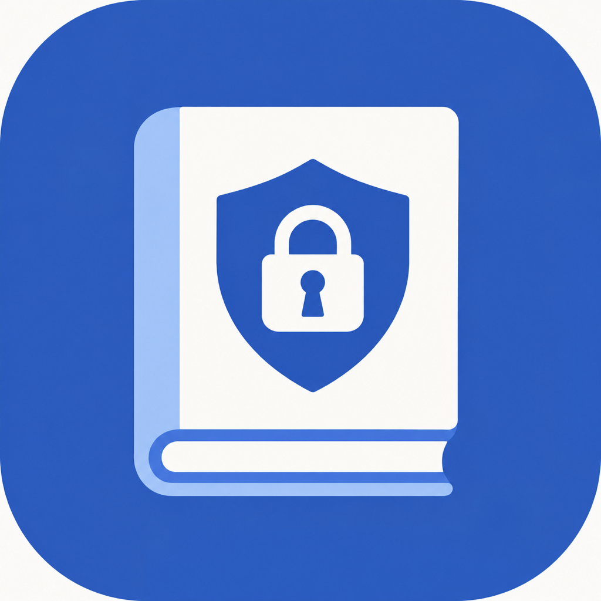

# LanR2der

**An iOS comic reader for LANraragi and R2, with a local bookshelf, offline downloads and privacy controls.**

[中文](README.md) · [Download IPA](https://github.com/Fuzage/LanR2der/releases/latest) · [Server project](https://github.com/Fuzage/LANraragi-R2)

## Installation

Download `LanR2der-1.0.1-unsigned.ipa` from [Releases](https://github.com/Fuzage/LanR2der/releases). Version **1.0.1 (Build 3)** requires **iOS 26.0 or later**. The IPA is unsigned: sign and install it using your own signing tool. No developer certificate, account or provisioning profile is included. A SHA-256 checksum file is provided alongside the IPA.

## Connect your server

1. Deploy [LANraragi-R2](https://github.com/Fuzage/LANraragi-R2) with a reachable HTTPS address and a valid certificate.
2. Get your API Key from the LANraragi settings. It may be left empty if server password protection is disabled.
3. On first launch, enter your HTTPS address and API Key, then connect.
4. Change the connection later in Settings.

The app ships without comics or a preset personal library address. R2 bucket credentials are configured on the server, not in the app. See the [English server guide](https://github.com/Fuzage/LANraragi-R2/blob/main/README.en.md) for bucket creation, credentials and CORS.

The app targets the LANraragi-R2 backend. R2 uploads, bundled page reading and other extensions require that backend; complete compatibility with stock LANraragi has not been verified.

## Features

- **Local bookshelf:** wood styling, covers and cropped cover spines, adjustable books per row, nested folders, drag rearrangement, hover to group, and batch movement.
- **Library:** category sidebar, search, title/import-date sorting in both directions, recent reading, and batch selection.
- **Reader:** tap the sides to turn pages, tap the center for controls, optional page curl, reading direction and configurable preloading.
- **Metadata:** edit titles, tags, summaries and category membership; create categories.
- **Cache:** persistent cover, spine and page cache with a configurable 256 MB–8 GB budget. Whole-book downloads are stored separately and support offline reading.
- **Downloads:** queue progress and batch downloading. Local download removal, bookshelf removal and server deletion are separate actions. Server deletion asks for confirmation and the matching backend also cleans up R2 objects.
- **Uploads:** multi-file R2/VPS queues, category selection, original JPG/PNG/WebP preservation and embedded-image extraction from PDFs. Complex PDF pages use DPI rendering. R2 uploads reuse the server upload engine and send one page bundle per book. Keep the upload page open; backgrounding can pause or interrupt the upload.
- **Privacy:** six-digit PIN, Face ID or available device biometrics, optional locking on foreground return, and independent background screen blurring. API keys and privacy credentials use Keychain.

The bookshelf starts empty: choose books from your library to arrange them locally. Folder hierarchy is local and separate from server categories.

## Version 1.0.1

This public build removes the preset personal server address and opens connection setup on first launch. Existing saved connections and local data are retained. It includes uploads and metadata/category editing along with the bookshelf, reader, downloads and privacy features.

For upgrades, keep the same signing identity and app identifier where possible. Changing the identifier or uninstalling can affect local folders, downloads and Keychain access.

## Related projects

[LANraragi-R2](https://github.com/Fuzage/LANraragi-R2) · [LANraragi](https://github.com/Difegue/LANraragi)

This repository distributes app packages, documentation and issue tracking.
